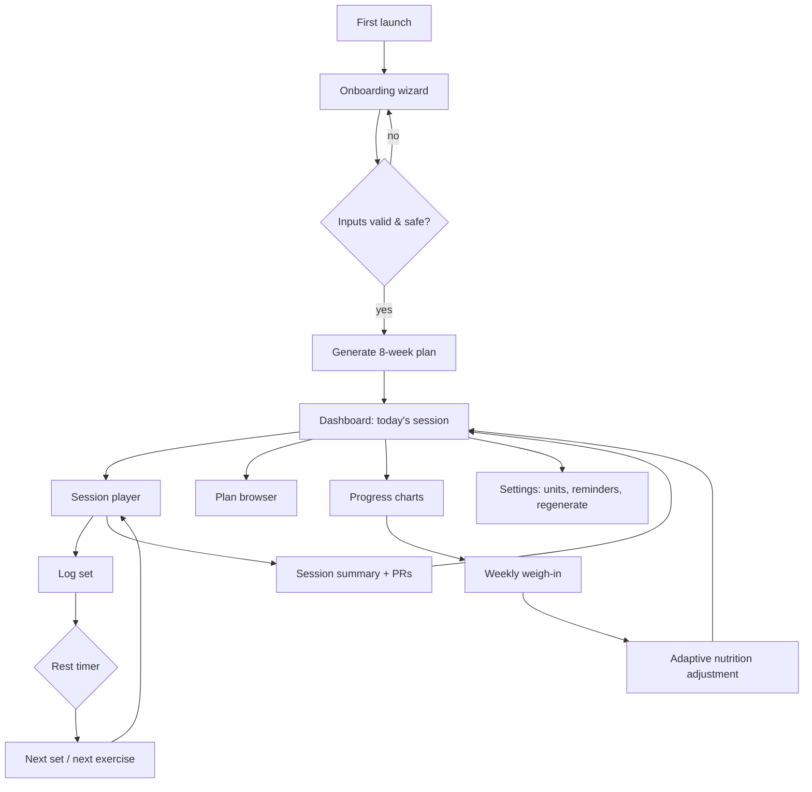
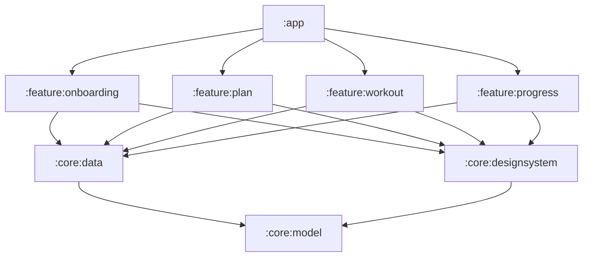

# TrainWithMe — End-to-End Product & Engineering Plan

| | |
|---|---|
| **Product** | TrainWithMe — personalised gym training coach for Android |
| **Document owner** | Engineering (Android) |
| **Status** | v1.0 approved — implementation tracked in §14 |
| **Last updated** | 2026-10-27 |
| **Target release** | v1.0.0 (MVP, offline-first, single APK) |

---

## 1. Executive summary

TrainWithMe is a native Android app that turns a short body-composition and goal
questionnaire into an **8-week, day-by-day gym programme**, then walks the user through
every session step by step — exercise by exercise, set by set — with a short demo video,
form cues, a rest timer and automatic progressive overload.

The product promise in one sentence:

> *"Tell us your body and your goal. We'll write your programme, coach every set, and get
> heavier/leaner with you week after week."*

Design pillars:

1. **Personalised, not generic** — plan is derived from body composition (weight, height,
   body-fat %, circumference measurements), experience, available equipment, weekly
   availability and goal; nutrition targets are derived from the same data.
2. **Guided execution** — the user never has to remember the plan. The session player is
   the core surface: current exercise, video, step-by-step technique, set logging, rest
   countdown, swap/skip, automatic next-week load suggestions.
3. **Offline-first & private** — all data stays on device, no account, no backend, no
   analytics SDK in v1. The app is fully usable in a basement gym with no signal.
4. **Explainable** — every generated number (calories, split, volume) shows *why*. Trust is
   the difference between a plan that is followed and one that is deleted.

Because the app must be handed over to be developed further in Android Studio, the
repository is a **standard Gradle multi-module Android project** (Kotlin 2.x, Jetpack
Compose, Material 3, Hilt, Room), with a pure-Kotlin domain module that is unit-testable
without an emulator.

---

## 2. Problem, users, jobs-to-be-done

Gym members fail at adherence, not at effort. The three most common failure modes:

| Failure mode | Root cause | TrainWithMe answer |
|---|---|---|
| "I don't know what to do today" | No programme, or a programme copy-pasted from the internet | Generated 8-week programme with a today card |
| "I don't know if I'm doing it right" | No coaching on the floor | Step-by-step cues + demo video + tempo guidance |
| "I stopped seeing progress" | No overload, no measurement | Auto load progression, weight/BF trend charts, PRs |

Target users:

| Persona | Profile | Primary need |
|---|---|---|
| **Ravi, 26 — the returning beginner** | 78 kg, 24 % BF, 3 days/week, commercial gym, goal: lose fat & keep muscle | "Just tell me what to lift and make it not intimidating" |
| **Sneha, 31 — the time-poor professional** | 62 kg, 28 % BF, 4 days × 45 min, gym at work, goal: recomp | "Maximise the 45 minutes I actually have" |
| **Arjun, 24 — the home lifter** | 70 kg, 15 % BF, 5 days/week, dumbbells + pull-up bar only | "Don't give me a plan that needs a leg-press machine" |
| **Karthik, 38 — the strength-focused lifter** | 88 kg, 20 % BF, 4 days, full gym, goal: strength | "Give me real percentages and long rests, not 20-rep burners" |

JTBD statements used to derive acceptance criteria:

- *When I join a gym after a break, I want a plan I can trust, so I don't waste the first month.*
- *When I'm standing at the rack, I want the exact next set and weight, so I don't have to think.*
- *When I finish a session, I want to know what improved, so I keep showing up.*
- *When my weight stalls for two weeks, I want the plan to react, so I don't have to become a nutritionist.*

**Anti-personas / out of scope for v1:** medical nutrition therapy, eating-disorder-adjacent
weight loss, competitive powerlifting peaking, live 1:1 coaching, social feed.

---

## 3. Competitive reference (guided-workout category)

The brief is "guided workouts like the *cult* app". Parity targets, expressed as
capabilities rather than copied features:

| Capability expected by users of guided-workout apps | v1.0 | Notes |
|---|---|---|
| Onboarding questionnaire that produces a plan | ✅ | body composition + goal + availability |
| Weekly schedule with today's session | ✅ | 8-week block, rest days, deloads |
| Video-led exercise guidance | ✅ | 14 demo clips, one per movement pattern (placeholder art, replaceable) |
| Step-by-step set-by-set execution | ✅ | player with logging, rest timer, RPE |
| Progress tracking | ✅ | weight/BF trend, volume, e1RM PRs, adherence |
| Nutrition targets | ✅ (targets only) | no food logging in v1 |
| Trainer-led audio/video classes, live sessions | ❌ (v2) | needs content production + streaming |
| Wearable / Health Connect sync | ❌ (v1.1) | roadmap |
| Wear OS companion | ❌ (v2) | roadmap |

---

## 4. Scope

### 4.1 v1.0 (this implementation)

1. **Onboarding** — 7-step wizard: identity, body composition, circumference measurements,
   experience + activity, goal + rate, equipment + availability, review.
2. **Plan generation** — 8-week mesocycle with deloads, split chosen from availability,
   exercise selection from a 36-exercise catalogue filtered by equipment, prescription by
   goal/experience, automatic scheduling of training days.
3. **Dashboard** — today's workout, week progress, streak, nutrition targets, quick weigh-in.
4. **Plan browser** — all 8 weeks, any day, exercise list with video preview and cues.
5. **Guided session player** — warm-up checklist, per-exercise video + cues, set logging
   (weight/reps/RPE), rest timer, swap/skip, finish early, summary with volume and PRs.
6. **Progressive overload** — next-session load/rep suggestions from the previous session's
   logs; deload weeks reduce volume and RPE.
7. **Progress** — weight & body-fat trend charts, measurement history, PR board (e1RM),
   session history, adherence %, weekly volume.
8. **Reminders** — opt-in local notification on training days (WorkManager).
9. **Settings/profile** — units (kg/lb), edit body composition, regenerate plan with
   confirmation, reminder time, theme, data export (JSON) & delete-all.

### 4.2 Explicitly out of scope for v1

Accounts/cloud sync, food logging, wearables, social/leaderboards, in-app purchases,
trainer marketplace, live classes, iOS.

### 4.3 v1.x candidates (post-MVP backlog)

Adaptive mesocycle re-planning from logged RPE, plate calculator, warm-up set calculator
with percentages, Health Connect, home-screen widget, exercise substitution learning,
Hindi/Tamil localisation, video streaming with CDN + captions, periodised cardio plans.

---

## 5. User journeys



Happy-path timing: onboarding ≈ 2 min 30 s, plan generation < 300 ms (in-process),
first session reachable in 3 taps from launch on a training day.

---

## 6. Functional specification

Acceptance criteria use Given/When/Then. **AC** = acceptance criterion.

### 6.1 Epic A — Onboarding & profile

| # | Requirement | AC |
|---|---|---|
| A1 | Collect name, sex, age (14–90), height (120–230 cm), weight (35–250 kg) | Invalid input blocks *Continue* with an inline error message |
| A2 | Body-fat % optional (3–60 %); if absent and neck/waist/(hip) provided, estimate with US Navy formula and label it "estimated" | Estimated value is visually marked `~` |
| A3 | Optional circumferences: neck, chest, waist, hip, arm, thigh | Stored per date, charted later |
| A4 | Experience: beginner / intermediate / advanced; activity: sedentary → very active | Drives sets, RPE, TDEE multiplier |
| A5 | Goal: build muscle / lose fat / recomp / strength / endurance | Drives calories, macros, sets/reps/rest |
| A6 | Equipment: full gym / dumbbell+bench / bodyweight+bands | Plan contains only performable exercises |
| A7 | Availability: 2–6 days/week, 30–90 min/session | Exercise count and split adapt |
| A8 | Review screen shows BMI, BMR, TDEE, calorie + macro targets, split name, why-this-plan | Before generating, user can go back and change anything |
| A9 | Safety guardrails | BMI < 18.5 + fat-loss goal, or age < 18 → warning card recommending professional supervision (not a hard block); calories never below 1200 (F)/1500 (M) |
| A10 | Disclaimer | "Not medical advice" shown and accepted at step 1 |

### 6.2 Epic B — Plan generation

| # | Requirement | AC |
|---|---|---|
| B1 | Generate a 8-week plan in one synchronous call (< 300 ms for 6 days/week) | Deterministic given the same seed date + profile |
| B2 | Split picked from days/week: 2–3 full-body, 4 upper/lower, 5 PPL+UL, 6 PPL×2 | Plan header shows split name and rationale |
| B3 | Training days spread with ≥ 1 rest day between repeated muscle groups when possible | Validator test asserts no >2 consecutive training days when days/week ≤ 4 |
| B4 | Exercise selection filtered by equipment + experience ceiling; no duplicate in a day; primary compound first | Unit-test asserts library filter respected for all profiles |
| B5 | Volume within evidence-based ranges: 10–20 sets/muscle/week (beginner 8–14) | Validator asserts per-muscle weekly sets within range |
| B6 | Deload in week 4 and week 8 (−40 % sets, RPE 6) | Week metadata `isDeload` visible in UI |
| B7 | Session fits requested duration (±10 min estimate) | Estimator: sets × (work + rest) + warm-up + transitions |
| B8 | Plan is persisted atomically and becomes active; regeneration archives the previous plan but keeps its logged sessions | Old sessions still visible in history |

### 6.3 Epic C — Dashboard & plan browser

| # | Requirement | AC |
|---|---|---|
| C1 | Today card: workout title, focus muscles, exercise count, est. minutes, `Start` | Tapping starts the matching session |
| C2 | Rest day: active-recovery suggestion + next training day | No `Start` button on rest days |
| C3 | Week strip showing done/today/upcoming/rest states | State derived from sessions, not stored flags |
| C4 | Nutrition card: calories + protein/fat/carbs, collapsible "how we calculated this" | Values match engine output |
| C5 | Plan browser: week selector 1–8, day list, day detail with exercise rows (video thumbnail, sets×reps, rest) | Deep-linkable per day |
| C6 | Empty state if no plan (e.g. after deleting data) → onboarding CTA | |

### 6.4 Epic D — Guided session player

| # | Requirement | AC |
|---|---|---|
| D1 | Pre-session overview: warm-up checklist, exercise list, est. duration, `Begin` | Warm-up tick-off is advisory, not blocking |
| D2 | Per exercise: looping demo video, name, target sets × reps, tempo, rest, 3–6 step cues, common mistakes | Video auto-plays muted loop; tap to pause |
| D3 | Set logging: weight (step 2.5 kg / 5 lb), reps (step 1), RPE chips 6–10, `Log set` | Pre-filled from previous session + progression suggestion |
| D4 | After logging: rest timer (exercise rest seconds) with `+15 s`, `Skip`, auto-advance | Timer survives rotation and backgrounding (timestamp-based) |
| D5 | Exercise navigation: previous, next, skip, swap (3 alternates from same pattern) | Swap is persisted for the session only |
| D6 | Pause / resume session; back press asks for confirmation | No data lost on rotation or process death (saved state) |
| D7 | Finish: summary (duration, working sets, volume kg, PRs, adherence vs plan) | Session stored with `COMPLETED` |
| D8 | Screen stays awake during a session | `FLAG_KEEP_SCREEN_ON` while player is visible |

### 6.5 Epic E — Progression

| # | Requirement | AC |
|---|---|---|
| E1 | Double progression: hit top of rep range on all working sets with RPE ≤ 8.5 → next time +2.5 kg (lower body/compound) or +1.25 kg (upper/isolation) and reset to bottom of range | Unit tests cover 6 scenarios |
| E2 | Otherwise, if all sets ≥ range bottom → +1 rep target next time | |
| E3 | Missed sets (< 80 % of prescribed) two sessions in a row → same load repeated, RPE target capped at 8 | |
| E4 | Deload week: prescription overrides with reduced sets/RPE | |
| E5 | Suggestion source + delta shown to user ("last time 60 kg × 8 → today 62.5 kg") | |

### 6.6 Epic F — Progress & measurements

| # | Requirement | AC |
|---|---|---|
| F1 | Weight trend line (7-day rolling average) over 30/90 days/all | Chart renders with ≥ 2 points, empty state otherwise |
| F2 | Body-fat trend when values exist | |
| F3 | Circumference history list + delta vs first entry | |
| F4 | PR board: best e1RM (Epley) per exercise, best volume set, with date | |
| F5 | Session history with volume/duration, tap → summary | |
| F6 | Adherence: completed / planned sessions per week, 8-week bar chart | |
| F7 | Quick weigh-in from dashboard writes a measurement and re-evaluates trend | |

### 6.7 Epic G — Reminders, settings, data

| # | Requirement | AC |
|---|---|---|
| G1 | Optional daily reminder at chosen time on training days only | WorkManager unique work; Android 13+ permission requested contextually |
| G2 | Units toggle kg/lb changes all displays and logs (storage stays kg) | Round-trip conversion lossless within 0.1 |
| G3 | Edit body composition → re-generate plan prompt (never silent) | |
| G4 | Export data to JSON via `ACTION_CREATE_DOCUMENT`; delete-all with typed confirmation | |
| G5 | Theme: system / light / dark | |

---

## 7. Personalisation engine (the "brain")

The engine lives in `:core:model` as **pure Kotlin** (no Android, no I/O) so it can be
unit-tested on the JVM and reused by a future backend. All functions are deterministic and
pure; dates are passed in.

### 7.1 Body metrics

Let `w` = weight kg, `h` = height cm, `y` = age, `bf` = body-fat fraction.

```
BMI            = w / (h/100)^2
LBM            = bf present ? w * (1 - bf) : null
FFMI           = LBM / (h/100)^2                     (normalised variant: FFMI + 6.1*(1.8 - h/100))
BMR (Mifflin)  = 10w + 6.25h - 5y + s                (s = +5 male, -161 female)
BMR (Katch)    = 370 + 21.6 * LBM                    (preferred when bf known)
TDEE           = BMR * activityMultiplier            (1.2 / 1.375 / 1.55 / 1.725 / 1.9)
Navy BF%       = 495 / (1.0324 - 0.19077*log10(waist-neck) + 0.15456*log10(height)) - 450      (male)
               = 495 / (1.29579 - 0.35004*log10(waist+hip-neck) + 0.22100*log10(height)) - 450 (female)
Waist-to-height= waist / height                      (risk flag > 0.5)
Healthy weight = BMI 18.5 – 24.9 range for h
```

### 7.2 Nutrition targets

| Goal | Calories | Protein | Fat | Carbs |
|---|---|---|---|---|
| Build muscle | TDEE × 1.12 | 1.8 g/kg | 0.9 g/kg | remainder |
| Lose fat | TDEE × 0.80 (floor: BMR × 1.05, min 1200 F / 1500 M) | 2.2 g/kg (obese: 2.4 g/kg LBM) | 0.8 g/kg | remainder |
| Recomp | TDEE × 1.00 | 2.0 g/kg | 0.9 g/kg | remainder |
| Strength | TDEE × 1.08 | 1.8 g/kg | 1.0 g/kg | remainder |
| Endurance | TDEE × 1.00 | 1.6 g/kg | 0.9 g/kg | remainder |

Carbs are `max(0, calories - 4·protein - 9·fat) / 4`; if negative, fat is reduced to
`0.6 g/kg` and carbs to 0 before protein is touched. Fibre = 14 g / 1000 kcal, water =
35 ml/kg — shown as secondary info.

**Safety rails:** rate-of-loss > 1 % BW/week or gain > 0.5 % BW/week (0.25 % for
intermediate+) triggers a plan note; BMI < 18.5 with fat-loss goal triggers the
professional-guidance card; calorie floor enforced.

**Adaptive adjustment (weekly, after ≥ 2 weeks of data):**

```
trend = mean(last 7 days weight) - mean(previous 7 days weight)   // kg/week
target = goal.targetRateKgPerWeek
if (goal in {LOSE_FAT, BUILD_MUSCLE}) and |trend - target| > 0.15: calories += (target - trend) * 7700 / 7
clamp adjustment to ±250 kcal/week and to the calorie floor
```

### 7.3 Split selection

| Days/week | Split | Days |
|---|---|---|
| 2 | Full body A/B | Mon, Thu |
| 3 | Full body A/B/C | Mon, Wed, Fri |
| 4 | Upper / Lower ×2 | Mon, Tue, Thu, Fri |
| 5 | Push / Pull / Legs / Upper / Lower | Mon–Fri |
| 6 | Push / Pull / Legs ×2 | Mon–Sat |

Day templates are declarative slot lists (`MovementPattern` + emphasises `MuscleGroup` +
priority), which keeps selection data-driven:

```
DAY_TEMPLATE("Upper A") = [
  Slot(SQUAT-ish: HORIZONTAL_PUSH, primary=CHEST, priority=0, compound=true),
  Slot(HORIZONTAL_PULL,  BACK,  0, true),
  Slot(VERTICAL_PUSH,    SHOULDERS, 1, true),
  Slot(VERTICAL_PULL,    BACK,  1, true),
  Slot(LUNGE,            QUADS, 2, false),
  Slot(ISOLATION_TRICEPS, TRICEPS, 3, false),
  Slot(ISOLATION_BICEPS,  BICEPS, 3, false),
  Slot(CORE,             CORE,  4, false)
]
```

Selection algorithm per day:

1. `candidates = library.filter { equipment ⊆ profile.allowed && difficulty ≤ ceiling && pattern == slot.pattern }`
2. Drop exercises already used in the day; prefer compound-first for `priority = 0`.
3. Rank by `difficulty` (closest to experience), then goal-fit (e.g. fat loss prefers
   higher-energy patterns), then stable hash for determinism, then id.
4. If empty → fall back to `slot.alternates` pattern list (e.g. machine press → push-up);
   if still empty, skip the slot and log a diagnostic (engine never produces an
   unperformable exercise).
5. Truncate to `exerciseCount(sessionMinutes)`:
   `≤30 min → 4, ≤45 → 5, ≤60 → 6, ≤75 → 7, else 8` (never truncate the first two slots).

### 7.4 Volume & intensity prescription

`sets(role, experience, goal, week)`:

| | Beginner | Intermediate | Advanced |
|---|---|---|---|
| Compound main | 3 | 4 | 4–5 |
| Compound secondary | 3 | 3 | 4 |
| Isolation | 2–3 | 3 | 3–4 |

Goal modifiers: strength → −1 set on isolation, +1 on main compound, reps 3–5, rest 180 s;
build muscle → reps 6–10 compound / 10–15 isolation, rest 120/75 s; fat loss → 12–15 reps,
rest 45–60 s + optional finisher; recomp → 8–12, rest 90 s; endurance → 15–20, rest 45 s.

Mesocycle (8 weeks):

| Week | Label | Volume | RPE target |
|---|---|---|---|
| 1 | Introduction | 80 % sets (min 2) | 7 |
| 2 | Accumulation | 100 % | 7.5 |
| 3 | Accumulation | 100 % | 8 |
| 4 | **Deload** | 60 % | 6 |
| 5 | Intensification | 100 % | 8 |
| 6 | Intensification | 110 % (round) | 8.5 |
| 7 | Overreaching | 110 % | 9 |
| 8 | **Deload + retest** | 60 % | 6 |

Warm-up: 5 min general + focus-specific drills + ramp-up sets at 40 %/60 %/80 % of the
first working load (first compound only). Cooldown: 4 static stretches matched to the day's
focus muscles. Both are generated from template tables, not hard-coded per day.

### 7.5 Progression (see also Epic E)

```
suggest(prev: List<SetLog>, rx: SetPrescription, exercise: Exercise): Suggestion
  working = prev.filter { !it.isWarmup }
  if working.isEmpty()                -> Suggestion(load = null, reps = rx.low, note = FIRST_TIME)
  top     = rx.high
  hitTop  = working.all { it.reps >= top } && working.avgRpe <= 8.5
  if hitTop && allSetsCompleted       -> load += increment(exercise), reps = rx.low
  else if working.all { it.reps >= rx.low } -> reps = min(top, maxReps + 1), same load
  else                                -> same load, reps = rx.low, note = CONSOLIDATE
```

`increment`: 2.5 kg lower-body compound, 1.25 kg upper compound, smallest available plate
step for isolation (1 kg). e1RM = `w * (1 + reps/30)` (Epley) for the PR board.

Increment logic is exposed in the UI so the user sees the *reason*, not just a number.

---

## 8. Content: exercise catalogue & demo videos

### 8.1 Catalogue

36 exercises in `app/src/main/assets/exercises.json`:
`id, name, pattern, primaryMuscles[], secondaryMuscles[], equipment[], difficulty, isCompound,
video (pattern clip id), tempo, defaultRestSeconds, cues[3–6], mistakes[2–4], setup,
breathing, safetyNotes`.

Coverage matrix: every `MovementPattern × EquipmentAccess` combination used by the splits
has ≥ 1 candidate (enforced by a unit test). Cues are written as *actions* ("Brace, ribs
down, then push the floor away") not as marketing copy.

### 8.2 Video strategy

v1 ships **14 procedurally generated demo clips**, one per movement pattern, stored in
`app/src/main/assets/videos/*.mp4` (≈ 150–400 KB each, 720², H.264 baseline, no audio,
6–8 s loop). They are *schematic* — a clean animated figure with the barbell/dumbbell and a
phase caption — enough to communicate the movement and to exercise the full playback path.

- **Why placeholders:** real footage requires licensed talent, stylists, a studio and
  deliverables per exercise; it is a content-production task, not an engineering one.
  Schematic clips make the app demoable and the player fully functional today.
- **Upgrade path (v1.1):** drop licensed MP4s named `<exercise-id>.mp4` into the same
  folder — the player already resolves `asset:///videos/<video>.mp4`, then the exercise
  `video` field falls back to the pattern clip. A remote `videoUrl` field is read first, so
  switching to CDN streaming is a data change, not a code change.
- **Generator:** `tools/generate_demo_videos.py` (Pillow + ffmpeg) is committed so the team
  can regenerate or restyle the placeholders. Generation is a build-time offline task; the
  APK only contains the outputs.
- **Player requirements:** muted, looping, no autoplay-with-sound, pause when scrolled away,
  release player when the composable leaves composition, PiP not needed, captions shown as
  Compose text (not burned in).

### 8.3 Exercise images

List thumbnails are generated by the same script (`assets/thumbnails/*.jpg`, 320², ~10 KB)
so the catalogue rows are visually distinct without shipping photos.

---

## 9. Architecture

### 9.1 Module graph



Rules (enforced by review + Gradle deps):

- `:core:model` is a **pure Kotlin/JVM** module — no Android, no I/O, no Compose. Domain
  models + calculation engines only.
- `:core:data` is the only module that touches Room/DataStore/SharedPreferences/assets
  parsing. It exposes repository **interfaces** + Hilt bindings. No `Context` leaks above it.
- `:core:designsystem` owns theme, tokens and reusable composables. No feature imports
  another feature.
- Features expose exactly one entry point: `fun NavGraphBuilder.<feature>Screen(...)` plus
  their `@HiltViewModel`s. Cross-feature navigation is done by route string in `:app`.
- `:app` owns the `NavHost`, the `Application` class and top-level scaffolding. No business
  logic.

### 9.2 Layering inside a feature

```
ui/        @Composable screens + stateless content composables (previewable)
ui/state   UiState (immutable data class) + UiAction (sealed) + UiEffect (sealed, one-shot)
vm/        @HiltViewModel: maps domain → UiState, handles actions in viewModelScope
```

**Unidirectional data flow.** State is a single immutable `data class` exposed as
`StateFlow`; one-shot events (navigate, snackbar, beep) go through a `Channel` consumed as
a `Flow`. Compose reads state with `collectAsStateWithLifecycle()`. UI never calls a
repository directly; ViewModels never touch `Context` or Compose.

### 9.3 Threading & async

- Coroutines + Flow everywhere; repositories switch to `Dispatchers.IO` via injected
  dispatcher qualifiers (`@IoDispatcher`), so tests can inject a `TestDispatcher`.
- Room queries returning `Flow` for observation; `suspend` for writes.
- No `GlobalScope`, no `runBlocking` outside tests.
- Rest timer is **timestamp-based** (`endAt: Instant`), ticked by a `Flow<Long>` on
  `Dispatchers.Default`, so backgrounding/rotation cannot desync it.

### 9.4 DI & configuration

Hilt (`@HiltAndroidApp`, `@AndroidEntryPoint`, `@HiltViewModel`, modules in `:core:data` and
`:app`). Version catalogue `gradle/libs.versions.toml` is the single source of dependency
versions — no hard-coded version strings in module scripts.

### 9.5 Error handling

- Repository results that can fail return `Result<T>`; the ViewModel maps failures to an
  `errorMessage` in `UiState` or an effect — never a crash dialog.
- Global uncaught-exception handler is *not* used to swallow errors; `StrictMode` is enabled
  in debug.
- Missing video/exercise/corrupt plan JSON degrades: player shows the cue list, plan
  regeneration is offered.

### 9.6 Offline, persistence & migrations

- 100 % offline. Room is the single source of truth; Compose observes Flows.
- Room schema export enabled (`schemas/` committed), destructive migration forbidden in
  release; explicit `Migration` objects for every version bump; a `MigrationTest` hook is
  documented for v1.1.
- Plan snapshots are immutable once activated (regeneration creates a new plan row and
  archives the old one), so historical sessions always resolve against the plan they were
  performed under.

---

## 10. Data model

```mermaid
erDiagram
    USER_PROFILE ||--o{ BODY_MEASUREMENT : has
    USER_PROFILE ||--o{ TRAINING_PLAN : owns
    TRAINING_PLAN ||--o{ WORKOUT_SESSION : schedules
    WORKOUT_SESSION ||--o{ SET_LOG : contains
    EXERCISE ||--o{ SET_LOG : referenced

    USER_PROFILE { long id PK }
    BODY_MEASUREMENT { long id PK, long profileId FK, long recordedAt }
    TRAINING_PLAN { string id PK, long createdAt, boolean isActive, string splitName, int weeks, string payloadJson }
    WORKOUT_SESSION { string id PK, string planId FK, int weekIndex, int dayIndex, string status }
    SET_LOG { long id PK, string sessionId FK, string exerciseId, int setIndex, double weightKg, int reps }
    EXERCISE { string id PK, string pattern, string primaryMuscles }
```

Design notes:

- **Plan payload**: the 8-week programme is a pure domain object graph. It is persisted as
  JSON (`kotlinx.serialization`) in `training_plan.payload_json` with header columns for
  querying/sorting. Rationale: the plan is an immutable document read as a whole, and
  normalising 8 weeks × 5 days × 6 exercises × 2 tables would add ~9 tables and join-heavy
  queries with no benefit. Sessions/logs — the mutable, query-heavy, per-row data — are
  fully normalised.
- **Logs are normalised** so progression, PRs and volume aggregates are SQL, not Kotlin.
- **Profile is a single row** (single-user app) with `id = 1`; measurements are appended.
- **Timestamps** stored as epoch millis, surfaced as `java.time.Instant` via Room type
  converters; `minSdk 26` means `java.time` is available without desugaring.
- **Indices**: `set_log(session_id)`, `set_log(exercise_id)`, `workout_session(plan_id)`,
  `body_measurement(recorded_at)`, `training_plan(is_active)`.
- **Units**: everything stored in metric (kg, cm); lb is a presentation concern.

---

## 11. Non-functional requirements

| Area | Requirement |
|---|---|
| **Performance** | Cold start < 1.5 s (Pixel 6); plan generation < 300 ms; 60 fps scrolling; no jank in the player; video start < 400 ms |
| **Size** | APK < 25 MB (R8 + resource shrink); assets ≈ 5 MB |
| **Compatibility** | minSdk 26, targetSdk/compileSdk 35; portrait + landscape + tablet/foldable layouts (window-size classes) |
| **Accessibility** | TalkBack labels on all interactive elements, 48 dp touch targets, contrast ≥ 4.5:1, no colour-only state (streak/adherence use icon + text), font scaling to 200 % without clipping, video has text equivalent (cues) |
| **Privacy** | No network permission in v1; no analytics; all data on device; export/delete in-app; `allowBackup=false` (body data is sensitive) |
| **Reliability** | Session survives process death; Room writes in transactions; no data loss on regeneration |
| **Battery** | No polling loops; timer stops when screen not visible; WorkManager only for reminders |
| **Localisation** | All user-visible strings in `strings.xml`; en-US shipped, locales ready |
| **Observability** | Timber (debug tree only) behind a `Logger` abstraction; no PII in logs |

---

## 12. Testing & quality gates

| Level | Scope | Tooling | Gate |
|---|---|---|---|
| Unit (JVM, `:core:model`) | metrics, nutrition, split selection, equipment filtering, prescription, progression, deload, scheduling, plan invariants | JUnit4 + kotlin.test | 100 % of engine branches, ≥ 85 % line coverage of `:core:model` |
| Unit (Android) | ViewModels with fake repositories, timer logic | JUnit4 + coroutines-test | every `UiState` transition covered |
| DAO (instrumented) | insert/query/aggregate correctness, JSON round-trip | AndroidX Test + Room | required set green on emulator |
| UI (instrumented) | onboarding happy path, start session, log a set, finish | Compose UI Test | smoke suite green |
| Manual | device matrix, TalkBack, font scale 200 %, dark mode, offline, process death (`adb shell am kill`) | checklist in §16 | sign-off |
| Static | `./gradlew lint` (warnings as errors for `:core:*`), `detekt` optional, CI on every PR | GitHub Actions | must pass |

Test data uses a `FakeProfileFactory` and a `TestExerciseLibrary` so engine tests are
readable and fast.

CI (`.github/workflows/android-ci.yml`): `./gradlew :core:model:test :app:assembleDebug lint`
on JDK 17, upload the debug APK artifact, cache Gradle.

---

## 13. Delivery plan & milestones

Estimates assume one experienced Android engineer; content production excluded.

| Milestone | Scope | Estimate | Exit criteria |
|---|---|---|---|
| **M0 — Foundations** | repo, Gradle multi-module skeleton, version catalogue, wrapper, CI, code style, README | 0.5 d | `assembleDebug` + `lint` green on CI |
| **M1 — Domain engine** | models, metrics, nutrition, catalogue schema, split/slot tables, plan generator, progression, tests | 3 d | engine tests green; plan invariants validated for all profile combinations in the test matrix |
| **M2 — Data layer** | Room schema/DAOs/converters, seed loader, repositories, DataStore settings, Hilt modules, DAO tests | 2 d | DAO tests green, no Android types leaked to engine |
| **M3 — Design system + app shell** | theme, tokens, shared components, NavHost, MainActivity, adaptive scaffolding | 1.5 d | app launches into onboarding/dashboard stub |
| **M4 — Onboarding + dashboard + plan browser** | wizard, plan generation wiring, dashboard, week strip, day detail | 4 d | user can complete onboarding and see a real plan |
| **M5 — Guided session player** | warm-up, video, cues, set logging, rest timer, swap/skip, summary, persistence, keep-screen-on | 4 d | end-to-end session logged and visible in history |
| **M6 — Progress, settings, reminders, polish** | charts, PR board, history, settings, export/delete, WorkManager reminders, accessibility pass, R8 | 3 d | v1.0 acceptance criteria met |
| **M7 — Hardening** | device matrix, TalkBack, process-death, lint/coverage gates, store assets | 2 d | release candidate signed |

Total ≈ 20 engineering days. Critical path: M1 → M2 → M5 (the engine and the player are the
product).

**Implementation status in this repository** (see §14) — all seven milestones are
implemented; the only non-code deliverable outstanding is licensed video footage (§8.2).

---

## 14. Implementation status map

| Milestone | Status | Where |
|---|---|---|
| M0 Foundations | ✅ | `settings.gradle.kts`, `gradle/libs.versions.toml`, `gradle/wrapper/**` (checksummed Gradle 8.9), `.github/workflows/android-ci.yml`, Dependabot |
| M1 Domain engine | ✅ + unit tested | `core/model/**` — 104 JVM tests, all green |
| M2 Data layer | ✅ | `core/data/**` — Room (7 entities, 6 DAOs), DataStore, versioned plan JSON codec, counters, reminder worker, Hilt modules |
| M3 Design system + shell | ✅ | `core/designsystem/**` (theme, 20+ components, charts, Media3 player), `app/**` (single `NavHost`, edge-to-edge shell) |
| M4 Onboarding / dashboard / plan | ✅ | `feature/onboarding/**`, `feature/plan/**` (dashboard, plan browser, day detail) |
| M5 Session player | ✅ | `feature/workout/**` — overview → player → summary, rest timer, resume |
| M6 Progress / settings / reminders | ✅ | `feature/progress/**`, `feature/plan/.../SettingsScreen.kt`, `core/data/.../reminder` |
| M7 Hardening | ⚠️ partially verifiable without hardware | R8 + resource shrinking + lint baseline configured; accessibility labels and dark mode in code; the device matrix in §16 is still manual |

### 14.1 How this build was verified

The implementation was authored in an environment without the Android SDK or an emulator, so the
first real Gradle build happened on GitHub Actions (`.github/workflows/android-ci.yml`). It is now
green: `:app:assembleDebug`, `testDebugUnitTest` for every module, `:app:lintDebug` and
`:app:assembleRelease` (R8 + resource shrinking) all pass on a clean runner.

Before that, and still useful as a fast local loop:

| Check | Result |
|---|---|
| `:core:model` compiled with the Kotlin compiler and its tests executed | **104 tests, 0 failures** (engine, calculators, plan validation, progression, progress stats, units) |
| Kotlin files parsed with a Kotlin grammar (71 files, main + test) | 0 parse errors |
| Import resolution across modules (project symbols, external symbols, unused imports) | 0 unresolved, 0 unused |
| Named-argument / arity checks against every project function signature | 0 mismatches |
| `@Composable` annotation check for functions that call composables | 0 violations |
| Gradle build files: version-catalogue aliases, `project(":…")` paths, included modules, wrapper checksum | 0 problems |
| Android resource references (`@drawable`, `@string`, `@style`, `R.*`) | 0 unresolved |
| Asset consistency: every referenced demo clip and thumbnail exists | enforced by `ExerciseCatalogueTest` |

The checkers were themselves mutation-tested (deliberately broken imports, arguments, resources and
Compose annotations) before being trusted, and they caught defects that are fixed in this branch.

The CI build then caught the things only a real compiler and a real lint run can catch, all fixed
here: suspend DAO reads inside non-suspend JSON builders, a missing `kotlinx.coroutines.launch`
import, `Double`/`Float` adherence, a feature-to-feature dependency (`ExerciseRow` moved into
`:core:designsystem`), a `FOREARMS` muscle group missing from the enum, the Compose BOM missing from
the `androidTest`/`debug` configurations, and Media3's `@UnstableApi` opt-in.

---

---

## 15. Risks & mitigations

| # | Risk | Likelihood | Impact | Mitigation |
|---|---|---|---|---|
| R1 | Generated plan is unsafe or inappropriate (injuries, unrealistic loads) | Med | High | Equipment/difficulty filtering, conservative default RPE, safety notes, deloads, calorie floors, BMI guardrails, prominent disclaimer, "consult a professional" copy |
| R2 | Placeholder videos look unfinished to stakeholders | High | Med | Clearly labelled as placeholders; upgrade path is data-only; cues carry the instructional load |
| R3 | Load progression suggests too much (no RPE honesty) | Med | Med | Cap increase at one increment/week; consolidate on missed sets; user can edit weight |
| R4 | Session state lost (rotation/process death) | Med | High | SavedStateHandle for in-flight session, timestamp-based timer, DB write per logged set |
| R5 | Room schema drift across releases | Med | Med | Exported schemas committed, explicit migrations, no destructive fallback in release |
| R6 | No automated UI tests for the player | Med | Med | Instrumented smoke test + extracted pure timer/state reducers unit-tested |
| R7 | Scope creep toward a food-logging app | Med | Med | Explicit non-goals in §4.2; nutrition is targets-only in v1 |
| R8 | Build fails on the reviewer's machine (toolchain drift) | Low | High | Version catalogue, Gradle wrapper pinned, documented JDK/SDK requirements, CI |
| R9 | Bodies outside BMI norms get nonsense protein targets | Med | Med | LBM-based protein for BMI > 30; guardrails; unit tests for edge cases |

---

## 16. Definition of Done & conventions

**Per feature:** spec AC met · unit tests · previews · TalkBack labels · dark mode verified ·
strings externalised · no lint errors · analytics-free · PR reviewed · PLAN.md status
updated.

**Code conventions:** Kotlin official style, 4-space indent, 100-col soft limit,
`snake_case` resources, `PascalCase` composables, `Screen`/`Content`/`ViewModel` naming
(`XScreen` = stateful wrapper, `XContent` = stateless preview), no wildcard imports,
immutable UI state, `sealed interface` for actions/effects, ktlint-compatible layout.

**Branching:** trunk-based on `main`, short-lived `feat/*` branches, conventional commits
(`feat(workout): ...`), squash merge, CI required.

**Manual QA checklist (M7):** fresh install onboarding · invalid inputs · regenerate plan ·
start session on rest day (blocked) · log sets offline · rotate during rest timer · kill
process mid-session and reopen · finish early · PR appears in progress · change units ·
export/delete data · reminder fires on training day only · font scale 200 % · TalkBack on
dashboard and player · dark mode · airplane mode.

---

## 17. Post-MVP roadmap

| Version | Theme | Highlights |
|---|---|---|
| v1.1 | Content & content pipeline | licensed footage, per-exercise clips, captions, plate/warm-up calculators, Health Connect weight import |
| v1.2 | Adaptive coaching | auto re-plan from RPE trend, auto-regulation (RIR), fatigue deload trigger, mesocycle chaining |
| v1.3 | Engagement | home-screen widget, streaks/achievements, shareable workout card, Wear OS tile |
| v2.0 | Platform | accounts + cloud sync, trainer marketplace, live classes, iOS via KMP shared `:core:model` |
| Later | Nutrition | food logging, barcode scan, integration with coaches |

---

## 18. How to open & run (handover)

1. `git clone` → open the **root folder** in Android Studio (Koala or newer).
2. Accept the SDK/licence prompts; JDK 17 is required (`Settings → Build → Gradle → Gradle
   JDK`).
3. Sync → run `app` on API 26+ device/emulator. No API keys, no backend, no network.
4. `./gradlew :core:model:test` for the engine test suite; `./gradlew lint` for static checks.
5. Version bumps go through `gradle/libs.versions.toml` only.

---

## Appendix A — Glossary

| Term | Meaning |
|---|---|
| Mesocycle | A training block (here 8 weeks) with progressive weeks and planned deloads |
| Deload | Planned reduction in volume/intensity to manage fatigue |
| RPE | Rate of perceived exertion, 1–10 scale (8 ≈ 2 reps in reserve) |
| e1RM | Estimated one-rep max from a set (Epley) |
| LBM | Lean body mass (weight − fat mass) |
| TDEE | Total daily energy expenditure |
| Double progression | Progress reps within a range, then add load and reset reps |
| Slot | A declarative movement-pattern position in a day template |

## Appendix B — Locked version matrix

Kotlin 2.0.21 · AGP 8.7.3 · Gradle 8.9 · JDK 17 · Compose BOM 2024.10.01 · Material 3 ·
Hilt 2.52 · Room 2.6.1 · Media3 1.4.1 · Navigation 2.8.4 · DataStore 1.1.1 ·
WorkManager 2.9.1 · KSP 2.0.21-1.0.28 · compileSdk 35 · minSdk 26 · targetSdk 35.
